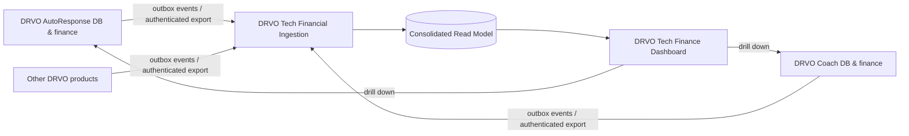

# DRVO Tech — Product-owned finance and consolidated reporting

**Decision (2026-10-14):** Each DRVO product owns its financial source of truth.
DRVO Tech provides consolidated *read-only* management analytics across products.
Product financial operations must never be edited from a central aggregate.

## Ownership and boundaries

| Layer | Owns | Does not own |
| --- | --- | --- |
| DRVO AutoResponse | Product plans, subscriptions, tenant billing, approved payments, product-side corrections | DRVO Coach finances or consolidated group books |
| DRVO Coach | Coach product plans, subscriptions, billing, payments, product-side corrections | AutoResponse finances |
| Other DRVO products | Their own financial operations and products | Other products' ledgers |
| DRVO Tech | Product registry, harmonization, consolidated reporting, drill-down and sync/reconciliation status | Independent edits of product payment/subscription records |

A product's **platform admin dashboard** is distinct from a customer workspace dashboard.
For AutoResponse:
- `/admin` and `/admin/financials`: DRVO AutoResponse owner finances.
- `/dashboard` and `/dashboard/billing`: a **customer's** workspace metrics and subscription.
- Future DRVO Tech /finance: cross-product owner finances only, with explicit product drilldowns.

## Shared financial vocabulary

Never conflate these concepts:

- **Collected cash / approved collections:** Payment activity explicitly approved/settled according to that product's evidence. Manual InstaPay approval is *internal verification*, not an external settlement guarantee.
- **Recognized revenue:** Separate accounting accrual/recognition ledger (usually over a subscription's service period). **Not currently implemented.**
- **Run rate / estimated MRR:** Active monthly subscription prices; a forward-looking snapshot that is **not** collections or recognized revenue. For AutoResponse current prices are estimates, not immutable contract snapshots.
- **Outstanding receivables:** Only amounts arising from an actual invoice/contractual liability. Payment *requests* alone are **not** receivables.
- **Pending payment requests:** Operational approval queue, **excluded** from paid revenue.
- **Refunds/reversals:** Must eventually be first-class signed ledger entries, reconciled by original transaction reference. **Not included in AutoResponse's current approval-only totals.**
- **Expenses, costs, taxes, profits:** Require source records or integrations before showing real net income / margin; don't infer them from payment records.

Use ISO-4217 currency codes; avoid summing mixed currencies. Until exchange-rate conversion is built, group consolidated money by currency and show EGP only for EGP-based top-line values. Timestamps stored as UTC, financial period based on explicit common timezone (recommend Africa/Cairo for local management) and disclosed in reporting.

## Integration design (target, not active yet)



**Preferred transport:** Transactional outbox per product + idempotent consumer on DRVO Tech; use authenticated periodic incremental pull where outbox is not yet feasible. Initial milestone can use daily/near-real-time snapshots, but track freshness and explicitly mark stale/missing products. No direct sharing of products' operational SQL tables.

Minimum common envelope:

```json
{
  "schemaVersion": 1,
  "eventId": "uuid",
  "sourceProduct": "DRVO_AUTORESPONSE",
  "sourceTenantId": "uuid",
  "sourceEntity": "PAYMENT",
  "sourceEntityId": "uuid",
  "sourceVersion": 1,
  "eventType": "PAYMENT_APPROVED",
  "occurredAtUtc": "2026-10-14T00:00:00Z",
  "currency": "EGP",
  "amountMinor": 150000,
  "planCode": "PRO",
  "reference": "product-native-reference"
}
```

**This sample schema is illustrative and not a real transaction.**

Event families to add when corresponding source records exist:
`PAYMENT_APPROVED`, `PAYMENT_REVERSED`, `REFUND_COMPLETED`,
`SUBSCRIPTION_STARTED`, `SUBSCRIPTION_RENEWED`,
`SUBSCRIPTION_CANCELED`, `SUBSCRIPTION_EXPIRED`,
`INVOICE_ISSUED`, `REVENUE_RECOGNIZED`, `EXPENSE_POSTED`.
Do not emit financial events from unverified request states.
For a given product, source payment ID plus event ID/version must be unique at ingestion.

### Security and correctness

1. **Source of truth remains in each product.** On a reversal, the product emits a compensating event or corrected version. DRVO Tech does not mutate product records.
2. **No double counting.** Unique key by `(sourceProduct, eventId)` and/or `(sourceProduct, sourceEntity, sourceEntityId, sourceVersion)`; handle out-of-order delivery, retries and replay.
3. **Identity boundary.** `BusinessID` is product tenant identity; never treat coincident IDs as an implicit cross-product customer match. Use an explicit group customer mapping service where necessary.
4. **Auth.** Signed requests/service tokens, least privilege read-only export scopes, short-lived credentials and audit logs. Never publish financial export via an unauthenticated endpoint.
5. **Cross-product hierarchy.** Every financial entry is tagged `productId`, `tenantId`, `currency`, `eventDate`, `sourceId`, and a canonical finance category.
6. **Reconciliation.** Daily compare aggregate amounts/counts against each source's product financial report, with event lag, last sync time, failures and duplicate counters.
7. **Accounting dates.** Store `occurredAt`, `recordedAt`, and optional `effectiveAt` / `settledAt`; never silently aggregate by a different date basis.
8. **RBAC.** Product admin grants product-specific visibility only; group finance access needs a separate DRVO Tech role. Exclude customer PII from the group summary unless needed and authorized.
9. **Immutable transaction amounts.** Payment and contract price snapshots must survive later plan repricing; future MRR should use the negotiated recurring price.

## DRVO Tech consolidated dashboard — target sections

- **Executive:** consolidated recognized revenue (when supported), approved collections, estimated MRR/ARR, costs/expenses, net profit (when supported), new vs returning paying businesses.
- **By product:** AutoResponse / Coach / each new product, with collections, MRR, subscriptions, payments pending, new paid accounts, refunds and churn where supported.
- **Trend & comparison:** month-over-month and year-over-year, normalized reporting period, product contribution distribution.
- **Subscriptions:** total active/trial/past-due/canceled, renewal calendar, expirations and cohort retention.
- **Payments:** pending approvals, verified collections, failed/refunded and reconciliation coverage.
- **Sync health:** each product's data freshness, last successful sync, event lag and exceptions.
- **Actions:** deep link to the owning product's admin screen for details or correction.

Group totals are computed from **canonical records** or reconciled snapshots, never by adding several UI totals that may use different date/currency definitions.

## Implementation sequence

1. ✅ AutoResponse: read-only owner financial reporting separated from tenant billing; collections vs estimated run rate clearly labeled. (GitHub feature branch, not yet deployed.)
2. Next: Record missing invoice/credit/refund/expense primitives per product before asserting net profit.
3. DRVO Tech: set up product registry and typed product finance contract with scoped, authenticated sync ingestion.
4. AutoResponse: publish idempotent export/outbox using existing audited payment and subscription changes.
5. Coach/other products: implement the same contract without sharing databases.
6. DRVO Tech: consolidate with per-product drill-down, currency separation, freshness indicators and reconciliation tests.
